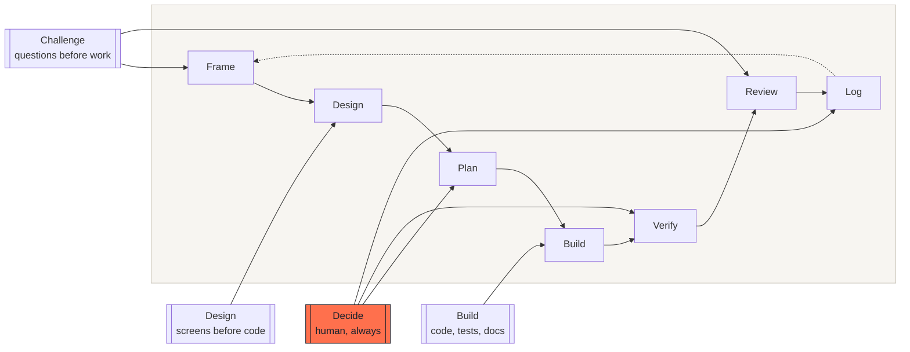

# D2B : Design to Build

A product development method for teams that build with AI agents.

Four roles, one cycle, and one rule that holds the rest together: **the human
decides what cannot be undone.**

The three outer roles produce. The fourth decides. The cycle turns until the
work is done, and every turn ends in something that runs.

---

## Who this is for

**Project leads and product managers** who now ship with agents and need a way
to keep control of scope, quality and risk. You do not need to write code to
use this method. Most of it is about what you ask for, what you look at, and
what you refuse.

**Builders** who work with agents daily and want the parts that are easy to get
wrong written down: how to specify, how to keep context affordable, how to
make data changes safe, and which failures look like success.

If you only read one thing, read
[the six principles](docs/00-principles.md). They take two minutes.

---

## The four roles

| Role | Produces | Never does |
|---|---|---|
| **Design** | Screens, flows, a design system | Decide scope or priority |
| **Challenge** | Questions, counter-proposals, reviews | Produce the deliverable |
| **Build** | Code, tests, documentation, migrations | Choose what to build |
| **Decide** | Arbitration, acceptance, release | Delegate what is irreversible |

Roles are not tools and not people. One person can hold several. An agent can
hold Build and part of Design. **Decide stays human, without exception.**

Read more: [roles and their boundaries](docs/01-roles.md).

---

## The cycle

Seven steps. Each one ends in something you can point at.

| Step | Ends in |
|---|---|
| **Frame** | A written problem, with what is explicitly out of scope |
| **Design** | Screens that a committee can read |
| **Plan** | A batch specification with acceptance criteria |
| **Build** | Code that runs, with its tests |
| **Verify** | Evidence: what was run, what was measured |
| **Review** | A decision: accept, adjust, or reject |
| **Log** | A written record of why |

Small batches. A batch that cannot end in something running is too big.

Read more: [the cycle, and its fast lane](docs/02-cycle.md).

---

## What this method does not do

It does not replace specialist review. Accessibility, security and legal
checks are still performed by people who do that work.

It does not make estimates reliable. It makes them smaller, and therefore
wrong by less.

It does not remove the need for product skill. An agent that is asked the
wrong question answers it very well.

It does not apply to everything. See
[when not to adopt it](docs/09-adopting.md#when-not-to-adopt-it).

---

## Start here

Three files, in the order that pays off fastest:

1. **[templates/agent-instructions.md](templates/agent-instructions.md)** ,
   the constraints your agent must never break. Fill this first. Half the
   failures in [the anti-pattern catalogue](docs/08-anti-patterns.md) are
   prevented by this one file.
2. **[templates/batch-spec.md](templates/batch-spec.md)**, one batch, with
   what is out of scope and how you will know it is done.
3. **[templates/decision-log.md](templates/decision-log.md)**, so anyone can
   pick up the work instead of re-deciding it.

A complete worked example is in
[examples/worked-example.md](examples/worked-example.md).

---

## Documentation

| Document | What it covers |
|---|---|
| [00. Principles](docs/00-principles.md) | Six rules, short enough to remember |
| [01. Roles](docs/01-roles.md) | What each role produces, and the boundaries |
| [02. The cycle](docs/02-cycle.md) | Seven steps, and when you may shorten them |
| [03. Human decisions](docs/03-human-decisions.md) | The six moments that stop the cycle |
| [04. Design](docs/04-design.md) | The screen as specification, the design system as contract |
| [05. Specs and context](docs/05-specs-and-context.md) | Writing a spec an agent follows, and what context costs |
| [06. Batch lifecycle](docs/06-batch-lifecycle.md) | From specification to merge |
| [07. Data safety](docs/07-data-safety.md) | Changing production data without losing any |
| [08. Anti-patterns](docs/08-anti-patterns.md) | Sixteen failures that look like success |
| [09. Adopting](docs/09-adopting.md) | Where to start, and when not to |
| [10. Positioning](docs/10-positioning.md) | Next to fast prototyping and heavy specification |
| [11. Glossary](docs/11-glossary.md) | Shared vocabulary |

---

## Anti-patterns

The catalogue is the most useful part of this repository for teams already
building with agents. Sixteen failures, in five families, each one observed
and each one written the same way: **the symptom**, **why review misses it**,
**what catches it**, **the rule**.

Every family opens with *what it costs the project*, in plain language, before
the technical detail.

→ [docs/08-anti-patterns.md](docs/08-anti-patterns.md)

---

## Contributing

What is most useful to receive: a failure you hit, written as the catalogue
writes them. A method is worth what its failure list is worth.

## License

[Creative Commons Attribution 4.0 International](LICENSE). Use it, adapt it,
sell work based on it. Keep the attribution.
