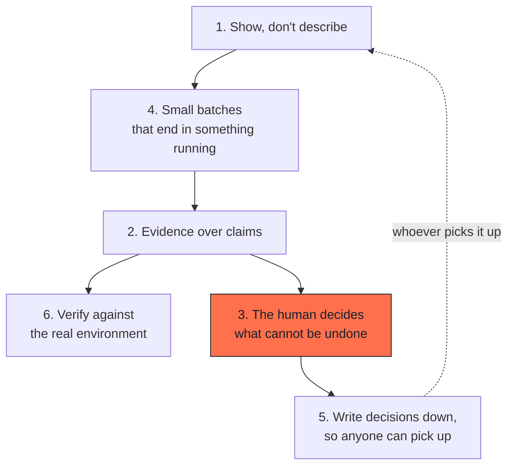

# Principles

Six rules. If you remember nothing else, remember these.

---

### 1. Show, don't describe

The screen is the specification. A paragraph describing a screen can be read
five ways; a screen can be read one way. Put the screen in front of the people
who decide, before anything is built.

### 2. Evidence over claims

Every batch ships its proof: what was run, what was measured, what was
observed. "It works" is not evidence. "Here is the output" is.

### 3. The human decides what cannot be undone

Deleting data, publishing, changing a price, granting access, sending a
message. An agent may prepare any of these. A person approves each one.

### 4. Small batches that end in something that runs

A batch too large to finish is a batch you cannot judge. If it cannot end in
something you can open and use, split it.

### 5. Write decisions down, so anyone can pick up the work

Agents do not remember. Neither do people, three weeks later, nor the person
who joins next month. A decision that is not written will be re-made,
differently, by someone with less context. A method is transmissible exactly
as far as its decisions are written down.

### 6. Verify against the real environment, not a convenient copy

A local database, a fresh install, a logged-out page: each one is a different
world. Test where the thing will actually run, or state plainly that you did
not.

---

## How the principles relate

A screen makes a batch small enough to finish. A finished batch can produce
evidence. Evidence is what a person needs in order to decide. A decision that
is written down is a decision nobody has to re-make: not the next session, not
the person who joins in three months.

---

## Where each principle is enforced

| Principle | Enforced by |
|---|---|
| Show, don't describe | [Design](04-design.md): screens and a design system before code |
| Evidence over claims | [Batch report](../templates/batch-report.md): a section that cannot be filled with opinions |
| The human decides | [Human decisions](03-human-decisions.md): six named stopping points |
| Small batches | [Batch lifecycle](06-batch-lifecycle.md): one batch, one change that can ship on its own |
| Write decisions down, so anyone can pick up | [Decision log](../templates/decision-log.md) |
| Verify for real | [Anti-patterns](08-anti-patterns.md): a whole family is about this |

---

## A note on the third principle

It is the one most often weakened in practice, and always for the same reason:
the agent is right most of the time, so approval starts to feel like a
formality.

The cost is asymmetric. An approval you did not need costs thirty seconds. A
deletion you did not catch can cost a week, or a customer. The rule is not
about trust in the agent. It is about which mistakes you can afford.
