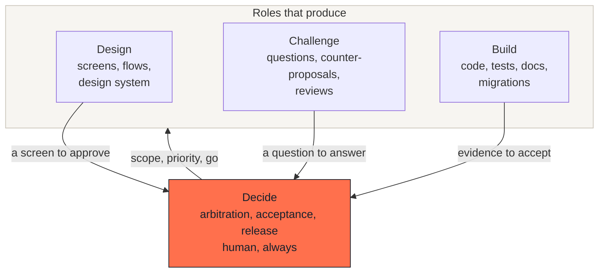

# Roles and their boundaries

## What this is

Four roles. Each one produces something different, and each one is forbidden
from doing something specific. The boundaries matter more than the
definitions: a method where every role can do everything is not a method.

A role is not a person and not a tool. One person can hold three roles in a
small team. An agent can hold Build and most of Design. The fourth role,
Decide, stays human.

---

## The four roles

### Design

**Produces** screens, user flows, and the design system that makes them
consistent.

**Never** decides scope or priority. A design role that chooses what ships is
a design role that will ship what is pleasant to design.

The output is not decoration. A screen is the most readable specification
there is: a committee that cannot read a technical document can read a screen
and say "the price should not be there".

### Challenge

**Produces** questions, counter-proposals and reviews. Its job is to make the
work harder to accept, not easier.

**Never** produces the deliverable. The moment the challenger writes the
answer, nobody is left to question it.

This is the role most often skipped, because it feels like friction. It is
friction. That is the point.

### Build

**Produces** code, tests, documentation, and data migrations (the reviewable
files that change stored data, see the [glossary](11-glossary.md)).

**Never** chooses what to build. An agent asked "improve the checkout" will
improve something, and it will not be what you meant.

### Decide

**Produces** arbitration between options, acceptance of a batch, and the
decision to release.

**Never** delegates what cannot be undone. See
[human decisions](03-human-decisions.md) for the six specific moments.

---

## The three boundaries

Each boundary exists because crossing it has a predictable cost.

| Boundary | What happens when it is crossed |
|---|---|
| Design does not set priority | The product becomes a sequence of pleasant screens, not a solution |
| Challenge does not produce | The review becomes self-review, which finds nothing |
| Build does not choose scope | The scope quietly becomes whatever was easiest to implement |

---

## How it fails

**One role holds everything.** Common in a team of one. The fix is not to hire
anyone: it is to *separate the moments*. Frame on Monday, design on Tuesday,
and challenge on Wednesday what you designed on Tuesday. Distance in time
substitutes for distance in person, imperfectly but usefully.

**The challenger reports to the builder.** The review then optimises for
agreement. If the same person holds both, write the challenge down *before*
starting to build, as questions the build must answer.

**Decide is treated as a formality.** Approval becomes a click. See the note
at the end of [the principles](00-principles.md#a-note-on-the-third-principle).

---

## How to check it

Ask of any batch:

- Can I name who held each role?
- Was there a written question the build had to answer?
- Was there a screen before there was code?
- Did a person approve each irreversible step, by name?

Four "yes" is a batch run by the method. Three or fewer is a batch that
happened to work.
