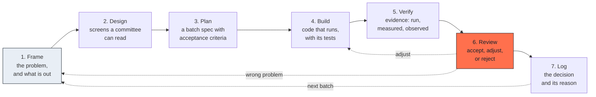
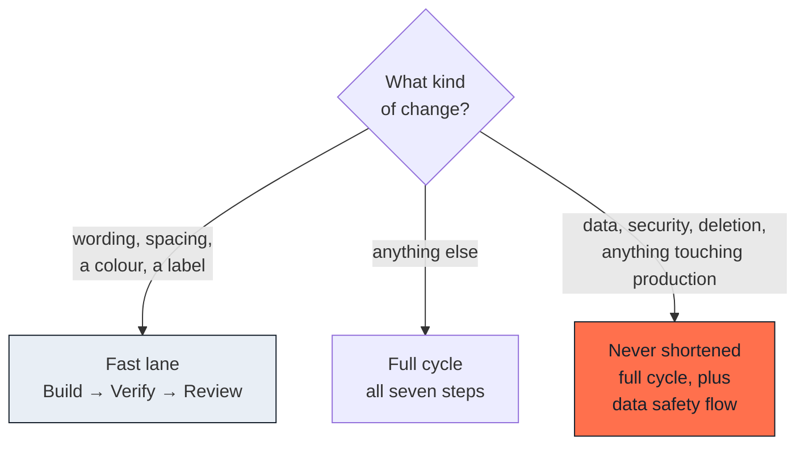

# The cycle

## What this is

Seven steps, repeated per batch. Each step ends in something you can point at,
which is how you know it is finished.

The cycle is short on purpose. A long cycle hides its failures until the end;
a short one surfaces them while they are still cheap.

---

## The seven steps

Two return paths matter as much as the forward one. **Adjust** returns to
Build: the problem was right, the work was not. **Wrong problem** returns to
Frame: everything downstream was well made and useless.

---

## What ends each step

| Step | Done when |
|---|---|
| Frame | The problem is written, and so is what you are *not* doing |
| Design | Someone who does not know the project can read the screens |
| Plan | Acceptance criteria exist, and they are checkable |
| Build | Something runs |
| Verify | There is output to look at, not an opinion |
| Review | A person said accept, adjust or reject |
| Log | The reason is written where the next session will find it |

The hardest to hold is **Frame**. Writing what you are not doing feels like
wasted time until the third time an agent helpfully builds it.

---

## The fast lane

Not every change deserves seven steps. Insisting that it does is how a method
gets abandoned.

### When you may shorten

- A wording correction
- A spacing or colour adjustment
- A label, a tooltip, an error message
- Anything whose worst outcome is "it looks slightly wrong for an hour"

Three steps are enough: **Build, Verify, Review**. You still produce evidence
and a person still accepts. You skip framing and design because the change is
its own specification.

### When you may never shorten

- **Data migrations.** Anything that writes to stored data.
- **Security.** Permissions, authentication, access rules, secrets.
- **Deletions.** Of anything, including things that look disposable.
- **Anything that touches production** directly rather than through a
  reviewed release.

These keep the full cycle *and* add the
[data safety flow](07-data-safety.md). The reason is not formality. It is
that these are the changes whose failures you cannot see by looking at the
screen.

### The test for which lane

Ask one question: **if this is wrong, how do I find out?**

If the answer is "I will see it", take the fast lane. If the answer is "a user
will tell me", or "I will find out at the next audit", or "I will not", take
the full cycle.

---

## How it fails

**The cycle is run once, at the start.** Framing happens in week one and never
again, so by week six the work is answering a question nobody asked any more.
The cycle is per batch, not per project.

**Verify produces a claim instead of evidence.** "Tested" is a claim. A
screenshot, a test run, a measured number is evidence. See
[evidence over claims](00-principles.md).

**Log is skipped because the decision feels obvious.** It is obvious today.
The whole point of writing it is the day it stops being obvious.

**The fast lane widens.** It starts with wording and ends with "it's only a
small database change". The list above is closed, not indicative.

---

## How to check it

Pick any merged batch from last month and try to answer:

- What was explicitly out of scope?
- What evidence was produced, and can I still see it?
- Who accepted it?
- Why was the main trade-off decided that way?

If you cannot answer the last one, the Log step is not happening.
