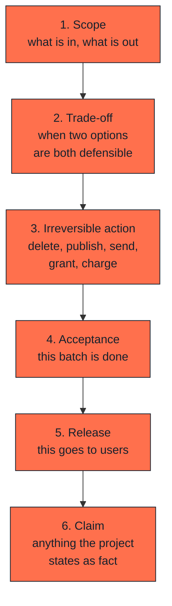

# Human decisions

## What this is

Six moments where the cycle stops and waits for a person. They are not
checkpoints to speed through. They are the places where being wrong is
expensive and being slow is cheap.

---

## The six moments

### 1. Scope

What the batch includes, and what it deliberately does not. An agent asked to
"improve" something will improve whatever is nearest. Deciding scope is
deciding what it may not touch.

### 2. Trade-off

When two options are both defensible, the choice belongs to whoever carries
the consequence. Speed against robustness, cost against control, simple now
against flexible later: none of these has a technically correct answer.

An agent asked to choose will choose, confidently, and the reasoning will
sound complete. That is the problem.

### 3. Irreversible action

Delete, publish, send, grant access, charge money, write to production data.
An agent may prepare all of these. A person approves each one, individually.

"Individually" matters. Approval of a plan containing six deletions is not
approval of the sixth deletion.

### 4. Acceptance

A batch is done when a person says it is, after looking at the evidence. Tests
passing is an input to that decision, not the decision.

### 5. Release

Shipping to users is separate from accepting the work. A batch can be correct
and still not be the right thing to release today.

### 6. Claim

Anything the project states as fact to the outside world: a number, a
capability, a comparison, a date. If nobody can point to where it comes from,
it does not ship.

This one is easy to forget because claims arrive inside otherwise excellent
drafts.

---

## What a stop looks like

A stop is not a pause for approval in general. It is a specific question with
a specific answer:

> "Removing the old pricing table deletes 400 rows that are not referenced
> anywhere I can find. Nothing I checked reads them. Confirm deletion, or
> should I archive instead?"

Compare with:

> "Ready to clean up the old data. Proceed?"

The first can be answered. The second can only be agreed to.

---

## How it fails

**Approval becomes a click.** The agent has been right forty times, so the
forty-first approval is automatic. The cost is asymmetric: an unnecessary
approval costs seconds, a missed deletion costs a week.

**The stop happens after the action.** "I've removed the unused table, let me
know if that was wrong" is not a stop. It is a report.

**One approval is stretched to cover many actions.** Approving a plan is not
approving each irreversible step inside it.

**A claim arrives inside a good draft.** The draft is well written, the
structure is right, and somewhere in paragraph four there is a figure nobody
can source. Review the claims separately from the prose.

---

## How to check it

For the last irreversible thing that happened in your project:

- Can you find the moment someone approved it?
- Was the question specific enough to be answered wrongly?
- If it had been wrong, would the approval have caught it?

The third question is the real one. An approval that could not have caught the
error was not a decision.
