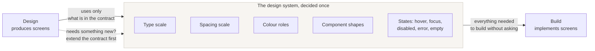

# Design

## What this is

Two ideas, and the whole design role rests on them.

**The screen is the specification.** Not a document that describes a screen.
The screen itself, readable by anyone who has a stake in the product.

**The design system is the contract** between design and build. It is what
makes a screen buildable without a conversation for every pixel.

---

## The screen as specification

A written specification is read differently by everyone. "A clear summary of
the order" produces five mental images in a room of five people, and the
disagreement surfaces after the build.

A screen produces one image. Someone looks at it and says "the total should
not be above the delivery date", a sentence they could not have written from
the description, but can say instantly from the picture.

### What this changes in practice

| Without screens first | With screens first |
|---|---|
| Disagreement surfaces during build | Disagreement surfaces during review of the screen |
| A correction costs a day | A correction costs an hour |
| Non-technical stakeholders approve a document they half-understand | They approve something they can actually read |
| "That's not what I meant" arrives at the demo | It arrives before anyone has built anything |

### Fidelity: how finished should a screen be?

High enough to be judged, no higher.

- **Too low**: a grey box labelled "chart" tells you nothing about whether the
  chart solves the problem.
- **Too high**: a pixel-perfect screen invites comments about the shade of
  blue when you needed a decision about the flow.

A useful rule: the screen should be finished enough that a stakeholder's
objection would be about the *product*, not about the *drawing*.

### What a screen cannot specify

Be honest about this, or the method over-promises.

- Behaviour over time: what happens while loading, what happens on failure
- Edge cases: empty, one item, four hundred items, a very long name
- Rules that are not visual: who may see this, how long it is kept

These belong in the batch specification, next to the screen. The screen
carries the layout and the intent; the text carries the rules.

---

## The design system as contract

A design system is a small set of decisions made once: spacing, type scale,
colour roles, component shapes, interaction states.

Its job is not beauty. Its job is **to remove the per-screen negotiation**. If
the spacing scale is decided, nobody argues about this card's padding. If the
colour roles are decided, nobody picks a new grey.

The dotted arrow is the rule that keeps a design system alive: when a screen
needs something the system does not have, you extend the system, then use it.
You do not make a one-off and promise to generalise it later.

### The states people forget

A design system that only describes the happy state is half a system. The
expensive omissions, in order of how often they are missed:

1. **Empty.** What the screen shows before there is any data.
2. **Error.** What a failure looks like, and what the user can do next.
3. **Loading.** What occupies the space while waiting, and whether the layout
   moves when content arrives.
4. **Focus.** How a keyboard user sees where they are.
5. **Too much.** A name with forty characters, a list with four hundred rows.

Each of these is a screen. If they are not designed, they will be invented
during build, differently each time.

---

## Working with an agent on design

An agent can produce screens quickly, which makes two failures easy.

**Volume instead of choice.** Twenty variations is not a design process. Ask
for two or three that differ in a way you can name: "one that puts the price
first, one that puts the outcome first".

**Drift from the system.** Generated screens tend to invent spacing and
colours. The design system has to be in the agent's instructions, as values,
not as a reference to a file it may not read.

---

## How to check it

- Can someone outside the project look at the screens and object to something
  real?
- Does the design system describe empty, error, loading, focus and overflow?
- When the last screen needed something new, was the system extended, or was
  a one-off made?
