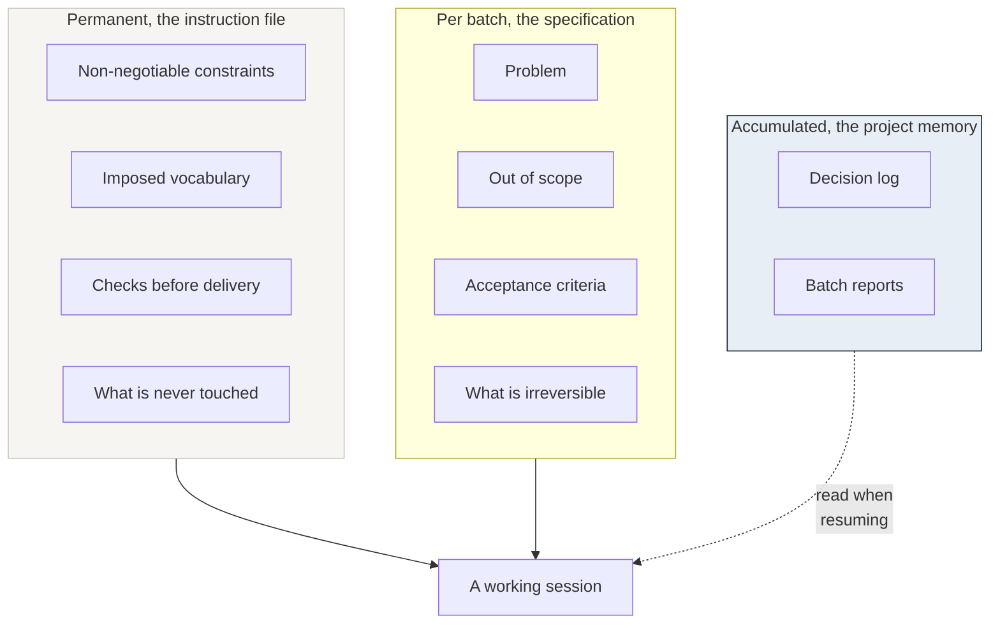

# Specs and context

## What this is

How to write a specification an agent actually follows, how to structure the
instruction file it reads every session, what context costs, and how a project
keeps its memory between sessions.

This is the most practical document in the repository. It is also where most
of the time is saved.

---

## A specification an agent follows

The difference between a spec that works and one that does not is rarely
length. It is **whether each sentence can be checked**.

| Instead of | Write |
|---|---|
| "Make the list fast" | "The list renders in under 200 ms with 500 rows" |
| "Improve the error handling" | "A failed save shows the server message and keeps the form filled" |
| "Clean up the old code" | "Remove `X`; nothing else changes behaviour" |
| "Make it accessible" | "Every control reachable by keyboard; focus visible; contrast at least 4.5:1" |

### The four sections that matter

**1. The problem, in one paragraph.** Not the solution. What is wrong today,
for whom.

**2. Out of scope, explicitly.** The most valuable section, and the one most
often skipped. An agent fills silence with initiative.

> Out of scope: the pricing page, the email templates, and any change to the
> database schema.

**3. Acceptance criteria.** Each one checkable by someone who did not write
it. If you cannot imagine the check, the criterion is a wish.

**4. What is irreversible.** Which parts of this batch cannot be undone, so
the stopping points are known before the work starts rather than discovered
during it.

### The sentence that saves the most time

> If something in this specification turns out to be wrong or impossible, stop
> and say so. Do not work around it silently.

Without it, an agent will find a way, and the way will be a surprise.

---

## The instruction file

One file, read at the start of every session, holding what must never be
re-explained. A template is in
[templates/agent-instructions.md](../templates/agent-instructions.md).

### What belongs in it

- **Constraints that must never be broken.** Security rules, data rules,
  anything with a cost you cannot absorb.
- **Imposed vocabulary.** The words your product uses, and the words it never
  uses. This prevents a slow drift that is very expensive to reverse once it
  is in forty files.
- **Checks before delivery.** The commands to run, and what counts as passing.
- **What is never touched.** Files, directories, environments.

### What does not belong in it

- Anything that changes per batch. That is the specification's job.
- Long explanations of the codebase. The agent can read the code; it cannot
  read your intentions.
- Aspirations. "Write clean code" costs context and changes nothing.

### Write the reason, not just the rule

A rule without its reason gets worked around the first time it is
inconvenient.

> Never use a time-based guard on a data migration. A trigger that writes to
> the row makes the timestamp meaningless, and the guard then silently
> protects nothing.

That is three lines instead of one, and it survives contact with a situation
its author did not anticipate.

---

## What context costs

Everything the agent reads costs money and attention. A long instruction file
is not thorough; it is expensive, and it dilutes the rules that matter.

### Where it goes

| Cost | Typical cause |
|---|---|
| Large | Pasting whole files when a section would do |
| Large | Re-reading the same file every session because nothing was written down |
| Moderate | Instruction files that explain the codebase instead of constraining it |
| Moderate | Long conversations where the early half is no longer relevant |
| Small but constant | Aspirational rules that cannot be checked |

### How to spend less

**Write decisions down instead of re-deriving them.** The cheapest context is
the paragraph that stops a question from being asked again.

**Point at files instead of pasting them.** An agent that can read the
repository does not need the repository in the conversation.

**Keep batches small.** A batch that fits in one session does not need to be
re-explained in the next one.

**Prune the instruction file.** When a rule has been obeyed for three months
without being tested, it may be a habit rather than a rule. Rules you keep
should be rules you would notice being broken.

---

## Continuity between sessions

An agent starts each session with no memory. The project's memory is whatever
is written down.

Two artefacts carry it:

**The decision log** answers *why*. Why this approach and not the obvious one;
what was tried and abandoned; which constraint forced which choice. Without
it, the next session re-proposes the thing you already rejected, with
confidence.

**Batch reports** answer *what happened*. What was built, what was measured,
what was left open. They are also where the honest statement of what was *not*
done lives.

### How to resume well

Opening a session with "continue" produces guesswork. Opening with:

> Read the decision log and the last two batch reports. Then tell me what you
> understand the current state to be, and what you think the next batch is,
> before doing anything.

produces a statement you can correct in thirty seconds, which is much cheaper
than correcting a day of work.

---

## How it fails

**The spec describes the solution instead of the problem.** The agent then
implements your guess rather than solving your issue.

**"Out of scope" is empty.** Scope grows silently, and the batch becomes
impossible to review.

**The instruction file becomes a wiki.** It grows to a thousand lines, costs
real money every session, and the three rules that matter are lost inside it.

**Decisions live in chat.** The conversation is lost or archived; six weeks
later nobody knows why the obvious approach was rejected.

---

## How to check it

- Open your last specification. Can a stranger check every acceptance
  criterion?
- Open your instruction file. Is there a rule you would not notice being
  broken? Remove it.
- Open your decision log. Does it answer *why*, or only *what*?
