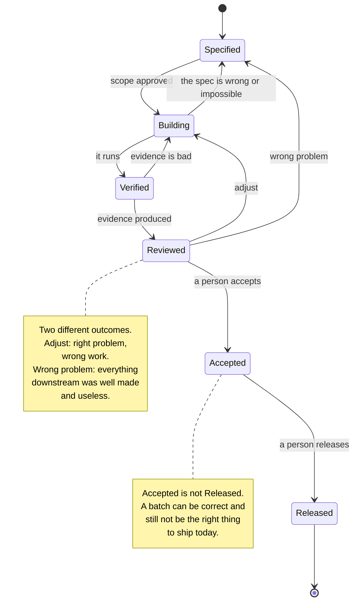

# Batch lifecycle

## What this is

The life of one batch, from the moment it is specified to the moment it is
merged. The cycle in [02](02-cycle.md) describes the steps; this describes the
states a batch passes through, and where it can go backwards.

A batch is the unit of work in this method. One batch, one mergeable change,
one decision to accept it.

---

## The states

---

## What each transition requires

| Transition | Requires |
|---|---|
| Specified → Building | Scope approved, including what is out |
| Building → Verified | Something runs. Not "compiles": runs |
| Verified → Reviewed | Evidence exists and can be looked at |
| Reviewed → Accepted | A named person accepted, after looking |
| Accepted → Released | A separate decision, possibly on a different day |

And the backwards ones, which matter more:

| Transition | Means |
|---|---|
| Building → Specified | The spec was wrong or impossible. **Say so early.** |
| Verified → Building | The evidence shows it does not work |
| Reviewed → Building | Right problem, wrong implementation |
| Reviewed → Specified | The problem itself was wrong |

The first of these is the one agents are worst at. An agent that hits an
impossible requirement will usually work around it rather than stop. This is
why the instruction file should say, explicitly, to stop and say so.

---

## Sizing a batch

A batch is the right size when it can end in something that runs, within one
working session.

**Too big**, in order of how often it happens:

- It touches more than one area of the product
- It contains both a data change and a feature
- Its acceptance criteria cannot all be checked at once
- You cannot say what "done" looks like in one sentence

**Splitting a batch that contains a data change** is almost always worth it.
Make the schema change its own batch, invisible to users, pushed first. Then
the feature batch, which only writes data into a structure that already
exists. See [data safety](07-data-safety.md).

---

## The report

Every batch ends in a report. A template is in
[templates/batch-report.md](../templates/batch-report.md).

It has four sections, and the third is the one that makes it useful:

1. **What was done.** Factual.
2. **What was measured.** Evidence, with the output.
3. **What was given up.** The trade-off you made, and what you lost.
4. **What is still open.** Including anything you could not verify.

A report that has nothing in sections three and four is usually a report
written from memory rather than from the work.

---

## How it fails

**The batch grows during build.** Something adjacent is obviously broken, so
it is fixed too. Now the review covers two things and judges neither well.
Note it, finish the batch, make the fix its own batch.

**Accepted and Released are merged.** The work is accepted, and therefore
shipped, in the same breath. They are different decisions with different
risks.

**The backwards paths are never used.** A project where no batch was ever
returned to Specified is a project where the review is not reviewing.

**The report is written to be approved.** It describes success and omits the
trade-off. Section three exists to make that uncomfortable.

---

## How to check it

Take the last five batches:

- How many ended in something that ran, within one session?
- How many reports name a trade-off?
- How many were ever sent backwards?

Zero on the last question is not a sign of quality.
