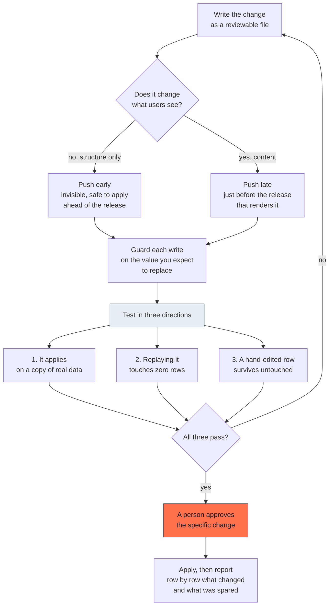

# Data safety

## What this is

Changing stored data is the one part of this work where a mistake is not
visible on screen, not caught by tests, and not reversible by undoing a
commit. This document is the flow that makes it survivable.

It applies to any change that writes to data people depend on: a schema
change, a content correction, a bulk update, a deletion.

---

## The flow



---

## The five rules

### 1. Separate structure from content

A change that adds a column changes nothing on screen. A change that fills it
does. Split them: push the structural one early, when it is harmless, and the
content one just before the release that renders it.

This gives you one short window where something visible can go wrong, instead
of a long one.

### 2. Guard every write on the value you expect to replace

Not on a timestamp. Not on "has this been modified". On the actual text or
value you believe is there.

```
update <table>
set <column> = <new value>
where <key> = <row> and <column> = <the exact value you expect>
```

If someone edited that row by hand since you wrote the change, the guard finds
nothing and the row is left alone. That is the correct outcome, and you report
it rather than overriding it.

### 3. Make replaying it do nothing

Run the change twice. The second run must touch zero rows.

This is not tidiness. A write that re-writes an identical value still fires
whatever runs on write, timestamps, audit rows, cache invalidation. Any later
logic that relies on "has this row been modified" is then permanently wrong,
and nothing will tell you.

The practical rule: a column whose old and new values are identical belongs
in neither the update nor its condition.

### 4. Test against a copy of the real data

Not against a seeded development database. The two diverge, and they diverge
exactly on the rows that have been edited by hand, which are the rows your
guards are about.

Take a dump of the real data, restore it locally, and run the three
directions against it.

### 5. Report what was spared

After applying, say per row: changed, or left alone because the value had
already been edited. A migration that reports "applied successfully" tells you
nothing about the rows it deliberately skipped, and those are the ones a
person needs to fix by hand.

---

## Ordering

Changes are applied in the order of their names, and that order must be the
order of application. Two consequences:

- Never choose a timestamp by hand. Generate it when the file is created.
- Before applying, check that no pending change is older than the last applied
  one. If it is, renumber it above, which is safe only because it has not
  been applied yet.

Once applied, a change file is immutable. Correcting it means writing a new
one.

---

## Privileged functions

A function that runs with elevated privileges in order to perform a data
operation needs three things, and the third is the one that gets forgotten:

1. **It checks the caller's authorisation itself.** Elevated privileges mean
   it bypasses the usual row-level protection, so without its own check it
   defeats the very barrier it is meant to respect.
2. **Its name resolution is fixed.** Otherwise a caller can place their own
   definitions in front of the ones you intended.
3. **The default execute permission is revoked.** Most database systems grant
   execution to everyone by default. If you do not revoke it, the function is
   reachable by any role, including anonymous ones.

Grant execution to exactly the role that needs it, and no other. A service
credential that bypasses row-level protection should not also be given a
second route to the same operation.

---

## How it fails

See the [data and migrations family](08-anti-patterns.md#family-1-data-and-migrations)
of the anti-pattern catalogue. Five of the sixteen entries are in this area,
which is proportionate to how expensive they are.

---

## How to check it

Before any data change is applied:

- Can I point at the guard, and say what value it expects?
- Did I run it twice, and was the second run zero rows?
- Did I test against real data, or against a convenient copy?
- Does a person know specifically what is about to change?
