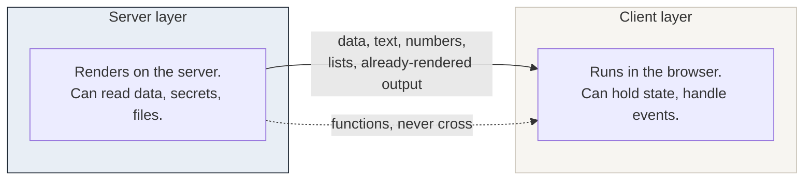
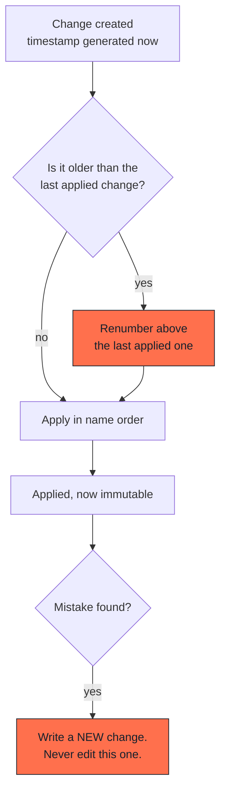

# Anti-patterns

Seventeen failures, in five families. Every one of them was observed, and
every one of them **looked like success at the time**. That is the property
they share, and the reason they are worth a document.

Each family opens with *what it costs the project*, in plain language. The
detail that follows is for whoever will fix it.

Each entry is written the same way:

> **The symptom.** What you see, or rather what you do not see.
> **Why review misses it.** Because nothing is wrong in the code as written.
> **What catches it.** The specific check.
> **The rule.** One sentence.

---

## Family 1. Data and migrations

### What it costs the project

This is the only family where a mistake cannot be undone by reverting code.
The data is changed, the previous values are gone, and the only recovery is a
backup and an awkward conversation.

The failures here are quiet. Nothing crashes. A correction silently does not
apply, or applies to rows it should have left alone, and you find out weeks
later when someone says "I fixed that, it came back".

Expect to spend more review time here than anywhere else. It is the cheapest
time you will spend.

---

### 1.1 Choosing a migration timestamp by hand

**The symptom.** A data change is written with a date typed by a person. It
works locally. Weeks later, applying a batch of pending changes fails, or
worse, applies them in an order nobody intended.

**Why review misses it.** The file is correct. The date looks reasonable. The
problem only exists in relation to what has already been applied elsewhere,
which is not visible in the file.

**What catches it.** Generating the timestamp at creation, and checking before
every application that no pending change is older than the last applied one.

**The rule.** Timestamps are generated, never typed. Before applying, renumber
any pending change that predates what is already applied.

---

### 1.2 Rewriting a change that has already been applied

**The symptom.** A mistake is found in a migration that has already run. It is
corrected in place. Everything works locally, because the local database is
rebuilt from scratch and sees the corrected version. The real environment
never sees the correction, because it already ran the old one.

**Why review misses it.** The diff shows a fix. A fix is good.

**What catches it.** Rebuilding locally proves nothing here, because it
replays from zero. The check is procedural: compare the list of applied
changes against the files, and treat anything already applied as read-only.

**The rule.** An applied change is immutable. Correct it with a new one.

---

### 1.3 A guard based on "has this been modified"

**The symptom.** A correction is written to skip rows that someone edited by
hand, using a modification timestamp. It skips everything, or nothing, and in
both cases silently.

**Why review misses it.** The logic is sound on paper: if the row was
modified, leave it alone. What is invisible is that something else already
writes to those rows (an automatic timestamp, an audit trigger, an earlier
migration), so every row looks modified, or none do.

**What catches it.** Testing against a copy of the real data, where the rows
have the history they actually have.

**The rule.** Guard on the value you expect to replace, not on whether the row
was touched.

---

### 1.4 An update that writes an identical value

**The symptom.** A change sets a column to the value it already has. Nothing
changes on screen. The change is correct and appears harmless.

**Why review misses it.** It *is* harmless, visually. The cost is elsewhere:
the write still fires everything that runs on write. Any later logic that
depends on "has this row been modified" is now permanently wrong, and nothing
reports it.

**What catches it.** Running the change twice. The second run must report zero
rows affected. This is the single most valuable check in this family.

**The rule.** A column whose old and new values are identical belongs in
neither the update nor its condition.

---

### 1.5 Guarding against the repository instead of the real data

**The symptom.** A correction is written with guards based on the text in the
source files. It applies cleanly and reports success. The real data is
unchanged, because the real data had drifted from the repository months ago.

**Why review misses it.** The guard matches the text you can see. The text you
cannot see is in the database.

**What catches it.** Taking the reference values from a dump of the real data,
never from the repository.

**The rule.** Guards are written against what is stored, not against what is
committed.

---

### 1.6 Checking that rows were touched instead of what was written

**The symptom.** A change reports "8 rows updated". Everyone is satisfied. One
of the eight columns was never actually written, because its condition could
not match.

**Why review misses it.** The row count is normal. The other columns in the
same statement were enough to make the condition true, so the row was
updated, but not in the way intended.

**What catches it.** Reading the resulting values, not the row count.

**The rule.** Verifying that a change touched rows is not verifying that it
wrote what it should.

---

## Family 2. Tests

### What it costs the project

A test suite that passes tells you nothing unless you know what it would catch.
The failures in this family produce green builds over broken software, which
is worse than no tests at all: it buys confidence you have not earned.

The cost shows up as a production incident after a release that "passed
everything".

---

### 2.1 A test that cannot fail

**The symptom.** A test asserts something that is true regardless of the code.
It passes forever, including when the feature is deleted.

**Why review misses it.** It reads like a test. It has an assertion. It is
green.

**What catches it.** Breaking the thing on purpose and checking that the test
goes red. If it does not, the test was decoration.

**The rule.** Every test you write, you break once, deliberately, to see it
fail.

---

### 2.2 Protected surfaces never rendered in the tests

**The symptom.** Hundreds of tests pass. The administration pages return an
error in production, because no test ever logged in and loaded one.

**Why review misses it.** Coverage looks high. The untested surface is behind
authentication, so it is skipped by habit and then forgotten.

**What catches it.** One test that signs in and loads every protected page,
failing on any console error, failed request, or near-empty page.

**The rule.** A surface that is never rendered in the tests is a surface you
have no information about.

---

## Family 3. Dependencies and build

### What it costs the project

These failures break the deployment, not the code. They are found at the worst
moment (during a release) and the local machine insists everything is fine.

The cost is a blocked release and an hour of confusion, usually at the end of
a day.

---

### 3.1 Trusting the lock file because the local install works

**The symptom.** Dependencies are repaired by installing a specific version.
It works locally. The lock file quietly loses its platform-specific binaries,
and a clean install elsewhere fails.

**Why review misses it.** The local machine already has the files on disk. The
missing entries are in the lock file, which nobody reads.

**What catches it.** A clean install from the lock file alone, in an empty
directory, before shipping.

**The rule.** A lock file is verified by a clean install, never by the machine
that produced it.

---

### 3.2 Reusing a build cache across different kinds of compilation

**The symptom.** A release produces output that matches no version of the
source: new markup with old styling, or the reverse. Nothing in the code
explains it.

**Why review misses it.** There is nothing to review. The source is correct,
the build reported success, and the inconsistency exists only in the
combination.

**What catches it.** Disabling the build cache for every release, and treating
"rebuild without cache" as a configuration rather than a step in a checklist
someone has to remember.

**The rule.** If two parts of a build can come from different moments, they
will, and it will not be reproducible.

---

## Family 4. Security

### What it costs the project

The worst case in this family is not downtime. It is a credential in a place
it should not be, or a route into your data that nobody knows exists.

These failures are also the least likely to be noticed, because nothing about
them is visible until they are used.

---

### 4.1 A privileged function shipped without revoking default permissions

**The symptom.** A function is created to perform an operation with elevated
privileges. It checks the caller's authorisation properly. It is still
reachable by every role, including anonymous ones.

**Why review misses it.** The authorisation check is right there in the code,
and it works. What is missing is not in the file: most database systems grant
execution to everyone by default, and nothing was revoked.

**What catches it.** Asserting, as a test, that each role either can or cannot
execute it, including the anonymous one.

**The rule.** Creating a privileged function is two steps: write the check,
and revoke the default.

---

### 4.2 A service credential that bypasses one protection but not another

**The symptom.** An automated process uses a credential that bypasses
row-level protection, and is assumed to be able to do anything. It fails on a
table whose table-level permissions were never granted to it.

**Why review misses it.** "Bypasses security" is taken to mean "has all
access". The two protections are independent, and the second one was never
configured.

**What catches it.** Failing loudly rather than falling back, and treating the
failure as information: if a credential cannot reach a table, that is often
correct and should stay that way.

**The rule.** Bypassing row-level protection is not the same as holding
table-level permissions, and the difference is usually deliberate.

---

### 4.3 An agent moving or rewriting a secrets file

**The symptom.** An agent, tidying up or testing a configuration, renames,
moves or edits the file holding credentials. The credentials are now
somewhere else, possibly somewhere tracked.

**Why review misses it.** The action is reasonable in isolation, and the agent
will explain it convincingly. The damage is in where the file ended up.

**What catches it.** An explicit, named prohibition in the instruction file,
and a test environment that does not require touching the real file at all.

**The rule.** The secrets file is named in the instruction file as untouchable:
not moved, not renamed, not edited, not deleted.

---

### 4.4 An invisible line break in a copied secret

**The symptom.** A credential is copied from a dashboard into a configuration.
Authentication fails with an error that describes something else entirely.
Everything looks correct, character for character.

**Why review misses it.** The extra character is a line break or a trailing
space. It is invisible in every interface that displays it, including the one
you are checking in.

**What catches it.** Comparing the length of the stored value against the
expected length, or displaying it with its boundaries marked.

**The rule.** When a credential fails and looks correct, measure it rather
than reading it.

---

## Family 5. Architecture and environments

### What it costs the project

These failures produce the most confusing symptoms, because the code is
correct and the behaviour is wrong. Diagnosis takes hours and usually starts
in the wrong place.

The cost is mostly time, and trust: a team that has been burned by an
environment problem stops believing its own tests.

---

### 5.1 Passing a function from the server layer to the client layer

**The symptom.** A page renders an error in production. The code is correct in
every file. The error message is about serialisation and mentions nothing you
wrote.

**Why review misses it.** There is a boundary in the architecture that is not
visible in the files. Each side is correct; only the crossing is not.

Only data crosses. A function cannot: there is no way to send it. The same
rule applies to anything that caches across a boundary, a cached function
can only take values it can store as part of its key.

**What catches it.** Rendering the page. Not compiling it, not type-checking
it: rendering it, in a test that fails on any console error.

**The rule.** Only data crosses an architectural boundary. If you need
behaviour on the other side, move the behaviour, not a reference to it.

---

### 5.2 Incomplete cache invalidation

**The symptom.** Content is updated. One page shows the new value, another
shows the old one. Clearing the browser cache changes nothing.

**Why review misses it.** A read that is cached without being labelled works
perfectly. It simply serves a stale value forever. There is no error, no
warning, no log line, the failure has no symptom except the wrong content.

**What catches it.** Two checks, and they catch different things:

- Reading the source: every cached read carries a label, and every label is a
  known one.
- Writing a unique marker into the data, confirming the pages do *not* show it
  yet, then triggering an update and confirming they all do.

**The rule.** One label per source of data, applied where the data is read,
never listed by hand on the pages that display it.

---

### 5.3 Editing content from a test environment that shares the production data

**The symptom.** Content is edited in a preview or staging environment. The
edit is saved correctly, the data really is updated. The public site keeps
showing the old value, including in a private browsing window, which rules out
the browser and sends the investigation in the wrong direction.

**Why review misses it.** Everything behaved correctly. The write succeeded.
The confirmation was honest. The cache refresh also ran correctly, in the
environment that triggered it.

**What catches it.** Nothing automated, which is why this one needs a rule and
a visible warning rather than a test.

**The rule.** Content is edited in the production environment. A test
environment that shares production data shows a visible banner saying so, and
does not pretend to be a safe place to edit.

---

## Ordering: why it is its own diagram

Three of the entries in family 1 are really the same underlying issue, the
order in which changes are applied must match the order in which they are
listed.

Applying changes out of name order is possible in most tools, and it is a
trap: six months later nobody can reconstruct what ran when by reading the
directory.

---

## Using this catalogue

Two ways, both useful:

**As a review checklist.** Before accepting a batch that touches data,
security or a build, read the relevant family.

**As a writing exercise.** When you hit a failure of your own, write it in
this format. The format forces the useful question: *why did review miss it?*
That answer is usually more valuable than the fix.
