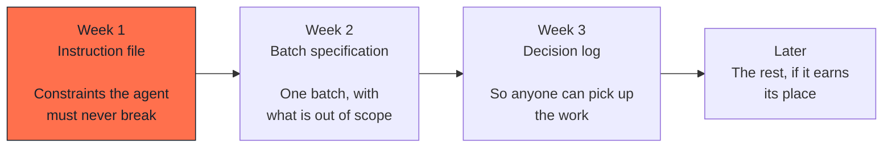

# Adopting the method

## What this is

Where to start, in what order, and when not to adopt it at all.

Adopting all of this at once does not work. Teams that try it spend two weeks
on process and go back to what they were doing.

---

## Start with three files

**The instruction file first**, because it pays immediately and costs an hour.
Half the failures in [the catalogue](08-anti-patterns.md) are prevented by a
file that says what must never happen.

**The batch specification second**, because it is where scope stops growing.
The section that matters is "out of scope", and it will feel unnecessary until
the first time an agent helpfully builds something you did not ask for.

**The decision log third**, because its value is delayed. You will not feel it
in week three. You will feel it in week ten, when someone asks why and the
answer is written down.

Everything else (the full cycle, the roles, the templates) can wait until
you have felt the gap it fills.

---

## What to expect

**Week one is slower.** Writing what you are not doing takes time you are not
used to spending.

**Week three is about even.** The time spent specifying is roughly the time
saved not rebuilding.

**Week six is faster**, and the difference is mostly in what does not happen:
fewer surprises at review, fewer "that's not what I meant", fewer corrections
to work that was already accepted.

These are not measurements. They are the shape of the curve, and the first
part of it is real: it is slower before it is faster, and a team that is not
told this will abandon it in week two.

---

## Adapting it

The method is not a standard. Parts of it will not fit.

**You can drop** the role separation if you are alone and the work is small.
Keep the *moments* (frame, then design, then challenge) even if the same
person holds all of them.

**You can drop** the formal batch report for fast-lane changes. Keep it for
anything that touched data.

**You should not drop** the human decision points, the data safety flow, or
the rule that a test must be seen to fail once. These are the parts that exist
because something went wrong without them.

---

## When not to adopt it

Be honest about these. A method applied where it does not fit discredits
itself.

**A prototype that will be thrown away.** If the code will not survive the
demo, the overhead buys nothing. Prototype freely. Just be sure that "it will
be thrown away" is a decision and not a hope.

**A codebase with no tests and no appetite for them.** This method assumes you
can produce evidence. If nothing can be verified, the cycle has no Verify step
and becomes paperwork.

**A team that does not control its releases.** If someone else decides what
ships and when, the Release decision is not yours, and half the cycle is
advisory.

**An organisation that will not let a human stop the work.** If the answer to
"can I pause for an approval?" is no, the third principle cannot hold, and
without it the rest is a style guide.

---

## Signs it is working

Not velocity. These:

- Someone said "that's out of scope" and it ended the discussion
- A batch was sent back to Specified, and nobody treated it as a failure
- A question was answered by reading the decision log instead of asking
- A data change reported that it had deliberately skipped a row
- A test was seen to fail on purpose

## Signs it is not

- The instruction file has grown past what anyone reads
- Every batch is accepted on the first review
- The fast lane is used for data changes
- The decision log stopped being written three weeks ago
