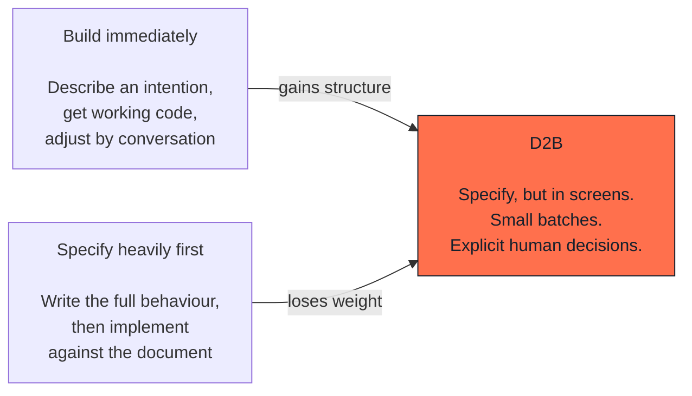

# Positioning

## What this is

Where this method sits between two ways of working that already exist: one
that builds immediately from an idea, and one that specifies heavily before
building anything.

This document names neither products nor other methods. It describes
approaches, because the approaches are what you are actually choosing between.

---

## The two poles

### Building immediately

You describe what you want and get something working, quickly. The feedback
loop is excellent and the start is genuinely fast.

What it does well: exploration, prototypes, anything where being wrong is
cheap.

Where it breaks: when the thing is going to live. Architecture is improvised,
decisions are made implicitly by whoever typed first, and nobody can say later
why it works the way it does. The rebuild arrives around the third or fourth
significant change.

### Specifying heavily first

You write the behaviour in detail, then implement against the document.
Nothing is improvised and the decisions are explicit.

What it does well: regulated work, large teams, anything where the cost of
being wrong is high.

Where it breaks: the document is read differently by each reader, it is out of
date before implementation finishes, and the loop is so long that a wrong
assumption is discovered after it is expensive. This is the failure mode that
sequential development was criticised for, and it returns whenever
specification is heavy enough to resist change.

---

## What D2B takes from each

### It keeps: specify before you build

The first approach is right that speed matters and wrong that specification is
the obstacle. Something has to be decided before code exists, or the code
decides it.

### It changes: the specification is a screen

A written specification is read five ways. A screen is read one way, and it is
read by people who cannot read a technical document, which is usually who
decides.

This is the central difference. Specification stops being a document to
approve and becomes something to look at.

### It changes: the human decision is named, not implied

Both poles leave this vague. Building immediately gives decisions to whoever
is typing. Heavy specification gives them to whoever wrote the document, weeks
earlier, in the abstract.

Here the decision points are listed, and they stop the work. See
[human decisions](03-human-decisions.md).

### It avoids: heavy documentation up front

A batch specification is one page. It exists for one batch and is not
maintained afterwards; the decision log carries what survives.

### It avoids: returning to sequential development

Small batches, each ending in something that runs, with return paths that are
used. The moment batches become large enough that specification and delivery
are weeks apart, you are back in the failure mode of the second pole, whatever
you call it.

---

## A summary you can give to a stakeholder

| | Build immediately | D2B | Specify heavily |
|---|---|---|---|
| Time before something runs | Minutes | Hours | Weeks |
| Who can read the specification | The person building | Anyone | Technical readers |
| When disagreement surfaces | At the demo | At the screen review | At delivery |
| Decisions are made by | Whoever types first | A named person, at named moments | The document author, in advance |
| Cost of a wrong assumption | Found late, cheap to fix early on | Found at the screen | Found late, expensive |
| Suits | Prototypes, exploration | Products that will live | Regulated or very large work |

---

## When another approach is the right one

**Build immediately** if the result is disposable. Do not add process to
something that will not survive the week.

**Specify heavily** if you are in an environment where the specification is a
contractual or regulatory artefact. Then the document is a deliverable in its
own right, and this method does not replace it, though the screens and the
decision log will still make it easier to write.
